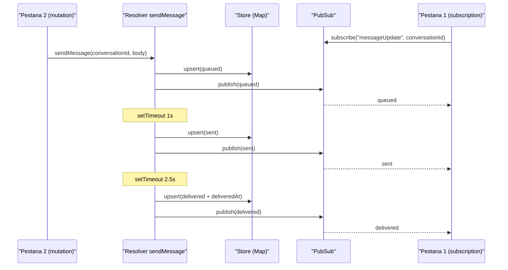

# Mini-backend de messaging con GraphQL Yoga (subscriptions en tiempo real)

Guia paso a paso para que lo escribas tu. Cada tarea trae el snippet clave de la parte que mas ensena; el resto es ensamblaje.

## Estado actual (lo que ya tienes)
- [src/schema.ts](src/schema.ts): schema con `hello`/`number` (lo vas a reescribir).
- [src/app.ts](src/app.ts): crea Yoga con el schema (no hace falta tocarlo).
- [src/server.ts](src/server.ts): levanta HTTP en `:4000` con GraphiQL (no hace falta tocarlo).
- Sin dependencias nuevas: `createPubSub` viene en `graphql-yoga`, y `crypto.randomUUID()` es global en Node 20.

## Flujo que vas a construir



## Archivos a crear/editar
- Nuevo `src/types.ts`: la discriminated union `Message` + el `switch` con `never`.
- Nuevo `src/store.ts`: el `Map`, el `pubSub` tipado y el helper `upsertMessage`.
- Editar [src/schema.ts](src/schema.ts): nuevos `typeDefs` y `resolvers`.
- Opcional: [test/app.test.ts](test/app.test.ts) y [requests.http](requests.http).

## 1) Tipos TS (`src/types.ts`) — union discriminada + exhaustividad con `never`
El almacen guarda `Message`. El `switch` sobre `status` es donde practicas el `never`:

```ts
export type Message =
  | { id: string; body: string; status: 'queued' | 'sent' }
  | { id: string; body: string; status: 'delivered'; deliveredAt: Date }
  | { id: string; body: string; status: 'failed'; error: string }

function assertNever(x: never): never {
  throw new Error(`Estado no manejado: ${JSON.stringify(x)}`)
}

export function statusLabel(m: Message): string {
  switch (m.status) {
    case 'queued': return 'En cola'
    case 'sent': return 'Enviado'
    case 'delivered': return `Entregado (${m.deliveredAt.toISOString()})`
    case 'failed': return `Fallo: ${m.error}`
    default: return assertNever(m) // si anades un status y no lo manejas, TS falla aqui
  }
}
```

## 2) Almacen + PubSub (`src/store.ts`) — el access pattern de Dynamo
`Map` = tabla, la clave = PK, el orden del array = SK. `upsertMessage` publica en cada cambio:

```ts
import { createPubSub } from 'graphql-yoga'
import type { Message } from './types.js'

export const conversations = new Map<string, Message[]>()

export const pubSub = createPubSub<{
  messageUpdate: [conversationId: string, payload: Message]
}>()

export function upsertMessage(conversationId: string, message: Message) {
  const list = conversations.get(conversationId) ?? []
  const i = list.findIndex((m) => m.id === message.id)
  if (i >= 0) list[i] = message
  else list.push(message)
  conversations.set(conversationId, list)
  pubSub.publish('messageUpdate', conversationId, message)
}
```

Nota: uso un `pubSub` singleton para simplificar. La forma mas idiomatica de Yoga es inyectarlo via `context` en [src/app.ts](src/app.ts) y usar `context.pubSub`; opcional.

## 3) Schema GraphQL (`typeDefs` en [src/schema.ts](src/schema.ts))
La union se aplana en un `Message` con `enum` de status y campos opcionales:

```graphql
enum MessageStatus { queued sent delivered failed }

type Message {
  id: ID!
  body: String!
  status: MessageStatus!
  statusLabel: String!
  deliveredAt: String
  error: String
}

type Conversation {
  id: ID!
  messages: [Message!]!
}

type Query {
  conversation(id: ID!): Conversation
}

type Mutation {
  sendMessage(conversationId: ID!, body: String!): Message!
}

type Subscription {
  onMessageUpdate(conversationId: ID!): Message!
}
```

## 4) Resolvers de lectura (`Query` + campos de `Message`)
Los field resolvers usan el narrowing de la union (por eso `deliveredAt`/`error` no son default):

```ts
Query: {
  conversation: (_: unknown, { id }: { id: string }) => ({
    id,
    messages: conversations.get(id) ?? [],
  }),
},
Message: {
  statusLabel: (m: Message) => statusLabel(m),
  deliveredAt: (m: Message) => (m.status === 'delivered' ? m.deliveredAt.toISOString() : null),
  error: (m: Message) => (m.status === 'failed' ? m.error : null),
},
```

## 5) Mutation `sendMessage` — el "Twilio simulado"
Dos `setTimeout` hacen de worker + webhook; cada `upsertMessage` publica:

```ts
Mutation: {
  sendMessage: (_: unknown, { conversationId, body }: { conversationId: string; body: string }) => {
    const id = crypto.randomUUID()
    const queued: Message = { id, body, status: 'queued' }
    upsertMessage(conversationId, queued)

    setTimeout(() => upsertMessage(conversationId, { id, body, status: 'sent' }), 1000)
    setTimeout(() => upsertMessage(conversationId, { id, body, status: 'delivered', deliveredAt: new Date() }), 2500)

    return queued // la respuesta inmediata es "queued"
  },
},
```

## 6) Subscription `onMessageUpdate` — el routing key
`subscribe` filtra por `conversationId`; `resolve` devuelve el payload publicado:

```ts
Subscription: {
  onMessageUpdate: {
    subscribe: (_: unknown, { conversationId }: { conversationId: string }) =>
      pubSub.subscribe('messageUpdate', conversationId),
    resolve: (payload: Message) => payload,
  },
},
```

## 7) Prueba de fuego
1. `npm run dev`.
2. Pestana 1 en `http://localhost:4000/graphql`, deja escuchando:

```graphql
subscription {
  onMessageUpdate(conversationId: "c1") {
    id status statusLabel deliveredAt error
  }
}
```

3. Pestana 2, lanza:

```graphql
mutation {
  sendMessage(conversationId: "c1", body: "Hola") { id status }
}
```

4. En la pestana 1 debes ver llegar `queued` -> `sent` (1s) -> `delivered` (2.5s). Ejercicio completado.

## 8) Opcional (limpieza)
- El test [test/app.test.ts](test/app.test.ts) espera `{ hello }`; al quitar `hello` fallara. Manten `hello` o actualiza el test (p. ej. probar `conversation`).
- Anade la query/mutation a [requests.http](requests.http) para REST Client. Nota: la subscription usa SSE, mejor probarla en GraphiQL.

## Conceptos que "veras con tus ojos"
- Discriminated union + `never` = estados imposibles no compilan.
- `Map<conversationId, Message[]>` = mismo access pattern que Dynamo (PK/SK).
- `setTimeout` + `pubSub.publish` = worker/webhook empujando eventos.
- `pubSub.subscribe(topic, id)` = fan-out en tiempo real filtrado por conversacion.